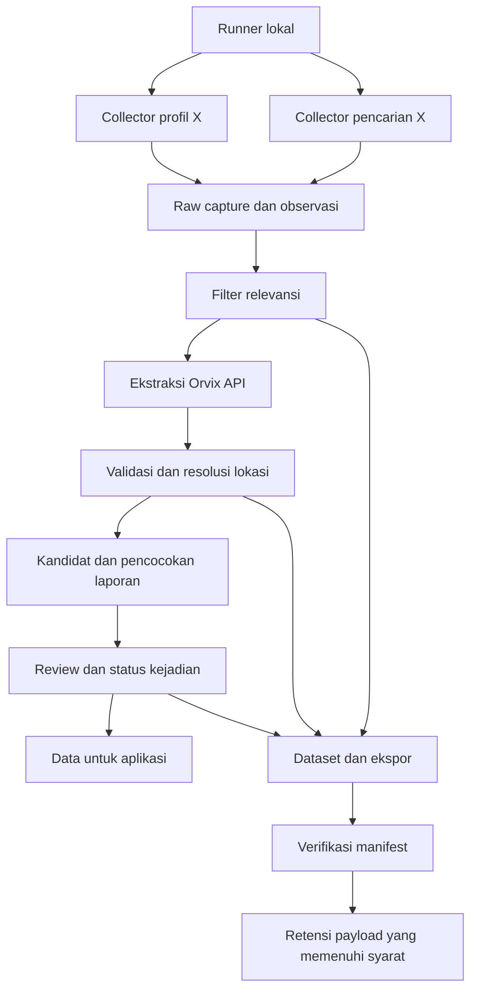

# Moobby — Product & Data Pipeline Specification

Versi: 0.3 draft · Tanggal: 21 Oktober 2026 · Bahasa: Indonesia

Status: rencana untuk ditinjau. Dokumen ini tidak menjalankan reset, migration, perubahan akses, maupun penghapusan data.

Dokumen ini merapikan SPEC awal dan keputusan percakapan menjadi acuan implementasi. **Dikunci** berarti dinyatakan pengguna. **Usulan** berarti rancangan yang masih perlu divalidasi saat implementasi. Kondisi repository berasal dari analisis yang ditempel pengguna; repository dan database aktif belum diaudit langsung. Hasil smoke test Orvix dan benchmark format berasal dari laporan pengguna.

## 1. Opportunity Statement

Komuter yang hanya mengenal perjalanan rutinnya membutuhkan informasi gangguan yang relevan terhadap rute dan arah perjalanan mereka, agar dapat memutuskan apakah akan menunggu atau mempertimbangkan transportasi lain.

Moobby diarahkan untuk menjawab: **rute atau segmen mana yang terdampak, bagaimana dampaknya, kapan informasi terakhir diperbarui, dan apakah waktu pemulihannya diketahui?** Ketersediaan laporan tidak otomatis membuktikan gangguan atau cakupan dampaknya.

## 2. Persona dan User Stories

Persona dari SPEC awal: Looqman, 24 tahun, komuter harian Jakarta yang mengenal rute biasa tetapi kesulitan mencari pilihan saat terjadi gangguan. Persona ini adalah persona rancangan, bukan hasil riset pengguna yang telah diverifikasi.

| Pengguna | Kebutuhan | Hasil yang diharapkan |
|---|---|---|
| Komuter | Melihat gangguan pada rute dan arah yang dipilih | Memahami dampak, sumber, dan kesegaran informasi |
| Komuter | Melihat lokasi diri serta transportasi sekitar | Menemukan pilihan yang dapat dipertimbangkan |
| Operator pilot | Menjalankan pengumpulan tanpa login berulang tiap script | Satu setup lokal yang dapat digunakan kembali |
| Reviewer | Memeriksa hasil LLM terhadap teks sumber | Memperbaiki label tanpa menimpa label awal |
| Pengembang NLP | Memiliki contoh gangguan dan non-gangguan | Dataset berlabel dengan asal label serta versi proses |

## 3. Dua Cakupan Pengembangan

### 3.1 MVP data: prioritas sekarang

KRL Jabodetabek; runner lokal; pengumpulan X; penyimpanan Supabase; ekstraksi melalui API Orvix; validasi; review sederhana; ekspor dataset; kemudian pencarian dan corroboration. Target sebelum allowance Orvix berakhir adalah pipeline yang dapat dievaluasi dan dataset yang dapat digunakan kembali.

### 3.2 MVP aplikasi: arah produk berikutnya

Mengacu SPEC awal: iOS 17 atau lebih baru, MapKit untuk peta, CoreLocation untuk lokasi saat aplikasi digunakan. Fitur: lokasi pengguna, gangguan pada koridor pilihan, dan transportasi sekitar. Detail API Apple akan diverifikasi ketika implementasi aplikasi dimulai.

Konflik pada SPEC awal: radius nearby ditulis 3 km pada MVP/acceptance criteria dan 1 km pada constraints. **Belum dikunci.** Usulan: default 1 km dengan pilihan memperluas sampai 3 km; jarak lebih jauh ditawarkan secara eksplisit, tanpa mengasumsikan pengguna mau membayar transportasi penghubung. Belum ada janji estimasi biaya atau rekomendasi alternatif otomatis.

Rute pilot aplikasi belum ditentukan. Cakupan penelitian KRL tidak berarti semua lintas sudah didukung aplikasi.

### 3.3 Di luar milestone data sekarang

Tracking kereta secara real-time, prediksi pemulihan, rekomendasi AI, perencanaan multimoda penuh, background GPS, notifikasi otomatis, deployment tanpa pengawasan, dan cakupan MRT/Transjakarta. Cron ditunda. Nearby lintas moda adalah arah aplikasi, bukan perluasan collector gangguan saat ini.

## 4. Keputusan yang Dikunci dan Batas Pilot

| Topik | Ketentuan |
|---|---|
| Akun terprofil | Hanya `x:commuterline`; `x:jalur5_` tidak dipantau sebagai profil |
| Sumber lainnya | Boleh ditemukan lewat pencarian; tidak ada tingkatan kepercayaan komunitas |
| Sumber dipercaya | `source_trusted` hanya menunjukkan sumber terprofil; bukan kebenaran kejadian |
| Corroboration | Dua akun berbeda dengan laporan cocok dalam jendela 24 jam; independensi lebih dalam tidak diperiksa |
| Waktu pencarian | `published_at` valid; post tanpa waktu valid dikeluarkan dari jalur langsung |
| Lingkungan | Lokal dahulu; diagnosis lengkap `time_mismatch` ditunda |
| Ekspor | Termasuk gangguan dan non-gangguan, label LLM, serta review bila tersedia |
| Retensi | Hapus payload yang memenuhi syarat setelah ekspor terverifikasi; hash deduplikasi tetap disimpan |
| Format LLM | Dikunci: data input CSV dan konten output CSV; envelope HTTP API tetap JSON |
| Pengganti LLM | Dataset Orvix dipakai untuk pembanding dan pelatihan NLP berikutnya |
| Tenggat | 1 November 2026, 23.59 WIB, berdasarkan keterangan pengguna mengenai allowance |

Usulan konfigurasi awal: polling 30 menit selama runner aktif; maksimal empat pencarian per jam untuk seluruh runner; keyword berlaku 24 jam dari waktu terbit pemicu. Angka ini adalah batas eksperimen, bukan jaminan X menerima aktivitas tersebut. Tidak membuat automation ChatGPT atau cron.

## 5. Kondisi Awal dan Apa yang Dipertahankan

Analisis repository yang diberikan menjelaskan collector profil X, adapter `raw.collection.v1`, uploader transaksional, dan lima tabel `collection`: sources, collection_runs, raw_contents, raw_snapshots, content_observations. Identitas post, versi tangkapan, dan observasi sudah dipisahkan dengan baik. Konsep ini dipertahankan; tidak menambah tabel raw_posts yang menduplikasi fungsinya.

Keterbatasan yang dilaporkan: teks kartu mengandung UI/engagement, post panjang belum diperluas, media/OCR belum tersedia, jenis repost/quote belum dikenali, coverage timeline terbatas, error kartu bisa terlewat, dan status keluar collector belum selalu mencerminkan kegagalan. Uji koneksi read-only belum membuktikan izin tulis.

`curate_x.py` lama adalah eksperimen terpisah. Pipeline baru harus mempunyai adapter dan kontrak eksplisit; hasil curated tidak dimasukkan melalui adapter raw.

## 6. Arsitektur Target



LLM mengekstrak klaim. Kode memvalidasi format, kutipan, waktu, kecocokan lokasi, dan aturan status. Reviewer menangani ambiguitas. Post adalah bukti sumber; post bukan identitas kejadian. Satu post dapat membahas beberapa kejadian, dan satu kejadian dapat memiliki beberapa post.

## 7. Penyederhanaan Session dan Akses

### 7.1 Tiga mekanisme yang berbeda

| Mekanisme | Kegunaan | Rancangan |
|---|---|---|
| Sesi login X | Mengakses X melalui Chrome/Playwright | Satu sesi lokal per operator/perangkat, digunakan collector secara bergantian |
| Koneksi database | Membaca/menulis PostgreSQL Supabase | Satu konfigurasi `DATABASE_URL` untuk seluruh runner lokal |
| API key Orvix | Memanggil LLM melalui HTTPS | `ORVIX_API_KEY` dari environment; tidak memakai sesi browser |

Reset tabel tidak otomatis memperbaiki login X atau menghilangkan kebutuhan kredensial database. Session pooler Supabase adalah mekanisme koneksi database, bukan sesi login collector X.

### 7.2 Usulan setup sekali pada pilot pribadi

Satu role runtime aplikasi dengan izin yang diperlukan, disiapkan sekali oleh pemilik database. Seluruh script memakai modul konfigurasi dan klien database yang sama. Identitas collector disimpan sebagai metadata, bukan dibuatkan SQL login terpisah per script. Kredensial admin/migration dipisahkan dari runtime. Jika nanti ada operator lain, masing-masing mendapat identitas akses sendiri; password pribadi tidak dibagikan.

URI diambil dari menu Connect proyek yang benar. Pilihan awal adalah Session pooler sesuai setup yang sudah ada, dengan pengaturan TLS mengikuti dokumentasi Supabase. Tidak menebak host/region atau mencetak URI lengkap ke log. Role runtime tidak memperoleh hak reset schema atau mengelola role. Grants dan RLS yang relevan diuji untuk akses baca/tulis nyata, termasuk akses yang seharusnya ditolak.

Untuk X, gunakan satu penyimpanan sesi lokal yang dibaca collector profil dan pencarian secara serial. Hanya satu proses boleh mengubah sesi tersebut pada satu waktu. Bila kedaluwarsa, runner berhenti dengan status `auth_required` dan meminta login manual sekali; jangan retry login tanpa batas. Pilihan penyimpanan mengikuti helper Playwright yang sudah ada setelah kode diperiksa, bukan mengasumsikan migrasi browser diperlukan.

Secrets disimpan lokal di luar version control, misalnya environment atau `.env` yang dimuat secara eksplisit. File sesi X, `.env`, dump berkredensial, dan log mentah tidak disertakan dalam dataset. Aplikasi iOS tidak menerima password database atau key Orvix.

### 7.3 Alur penggunaan yang dituju

1. Pemilik melakukan setup database dan environment sekali.
2. Operator melakukan login X sekali hingga sesi kedaluwarsa.
3. Pemeriksaan konfigurasi menunjukkan nama proyek/lingkungan yang disamarkan, schema version, kesiapan sesi, dan izin runtime.
4. Operator menjalankan satu runner; profil, pencarian, dan Orvix menggunakan konfigurasi bersama.
5. Runner menghasilkan ringkasan run, error, jumlah post, penggunaan token, dan ekspor.

Nama perintah CLI belum menjadi kontrak; implementasinya harus disesuaikan dengan repository aktual.

## 8. Rencana Reset Supabase

**Usulan strategi: reset terarah pada objek aplikasi Moobby di proyek yang sama**, setelah backup dan rehearsal. Tidak menghapus proyek Supabase atau schema platform seperti auth/storage. Daftar objek nyata wajib ditemukan sebelum menulis migration destruktif. Jika proyek memuat aplikasi lain, seluruh dependensinya harus dikecualikan.

| Tahap | Pekerjaan | Syarat selesai |
|---|---|---|
| R0 — Inventaris | Catat project ref, tabel, FK, views, fungsi, grants, policies, role, jumlah baris, dan histori migration | Daftar objek serta dependensi yang terkena perubahan tersedia |
| R1 — Backup | Hentikan penulisan; ekspor schema/data aplikasi dan konfigurasi akses tanpa menyebarkan secrets | Manifest, checksum, jumlah baris, dan lokasi backup tercatat |
| R2 — Desain | Finalisasi model tabel, migration berurutan, seed sumber tunggal, dan perubahan uploader | DDL dan kontrak uploader dapat direview sebagai satu perubahan |
| R3 — Rehearsal | Bangun schema bersih pada lingkungan terisolasi dan coba restore backup | Integritas data, restore, izin, retry, dan ekspor lolos |
| R4 — Review reset | Tampilkan target proyek, daftar objek dihapus/dibangun ulang, data yang dipulihkan, dan hasil rehearsal | Pemilik memberi persetujuan eksplisit untuk reset destruktif yang konkret |
| R5 — Eksekusi | Reset hanya objek yang disetujui; apply migration; seed; pulihkan data terpilih | Schema dan jumlah data sesuai manifest pemulihan |
| R6 — Smoke test | Baca/tulis fixture, upload ulang, ekstraksi fixture, ekspor, validasi izin | Tidak ada duplikasi dan runner siap digunakan |

Backup reset mencakup data yang perlu dipulihkan, bukan hanya dataset pelatihan. Migration reset tidak dianggap sebagai backup. Jangan menyalin perintah reset remote dari dokumentasi untuk dijalankan tanpa pembatasan target.

Rollback: hentikan semua writer; pertahankan backup; pulihkan schema/data/grants aplikasi dari backup yang sudah diuji; kembalikan versi runner yang kompatibel; cocokkan hitungan dan relasi sebelum melanjutkan. Tidak menjanjikan rollback transaksional untuk seluruh rangkaian operasi lintas layanan.

Persetujuan yang diminta saat ini hanya penyusunan dokumen. Reset dan penghapusan belum diotorisasi untuk dieksekusi.

## 9. Model Data Target — Usulan Logis

Nama dan pengelompokan berikut adalah desain, bukan klaim tabel sudah ada. DDL final dibuat setelah inventaris.

| Kelompok | Entitas | Tujuan dan aturan kunci |
|---|---|---|
| Collection | sources | Sumber pantauan, hanya commuterline aktif sebagai profil; akun penulis hasil pencarian disimpan terpisah dari profil |
| Collection | collection_runs | UUID run, versi collector, metode, status, coverage, error/skip counts, waktu mulai/selesai |
| Collection | raw_contents | Identitas unik platform + external_id; waktu pertama/terakhir terlihat |
| Collection | raw_snapshots | Teks, kualitas teks/waktu/media, capture hash; unik per content + hash |
| Collection | content_observations | Hubungan run, content, snapshot; unik per run + content dan FK yang konsisten |
| Processing | processing_jobs | Satu job per snapshot + pipeline version; status, lease, retry, hasil filter |
| Processing | llm_attempts | Riwayat percobaan API, model, prompt/schema version, output, token, durasi, error |
| Transit | stops, stop_aliases | Nama resmi, ID tetap, alias ternormalisasi; alias ambigu tidak dipaksa unik global |
| Transit | routes, route_patterns, pattern_stops | Lintas, arah/pola layanan, urutan stop; satu stop dapat berada di banyak pola |
| Transit | event_candidates, candidate_reports | Klaim kandidat dan hubungan banyak-ke-banyak dengan laporan/hasil ekstraksi |
| Transit | field_evidence | Nilai field, kutipan asli, snapshot, confidence model, status validasi |
| Transit | events, event_impacts | Kejadian yang diterima, rute/segmen/arah terdampak, dampak dan lifecycle |
| Transit | review_decisions | Riwayat keputusan, koreksi, alasan, waktu dan reviewer; label awal tetap ada |
| Operations | search_tasks | Keyword, pemicu, waktu berlaku, status, query history dan batas pencarian |
| Archive | export_batches, export_items | Keanggotaan ekspor tetap, manifest, checksum, verifikasi, status purge |
| Archive | processed_fingerprints, run_receipts | Dedup tanpa teks; bukti run pernah diunggah/diarsipkan dan digest batch |

Mulai dari collection, processing, dan archive; entitas rute/kejadian ditambahkan ketika tahap check dibangun. Pencarian membutuhkan gazetteer minimal dan kandidat terlebih dahulu.

Hash identitas, hash snapshot, dan digest batch adalah hal berbeda. Hash post mencegah pemrosesan ulang identitas yang sama, tetapi tidak membuktikan kesamaan payload suatu run. Untuk snapshot baru atau versi pipeline baru, reprocessing dilakukan secara eksplisit. Penghapusan payload tidak boleh menyebabkan run lama yang sudah diarsipkan dianggap run baru. Uploader memeriksa receipt terlebih dahulu dan menolak UUID sama dengan digest berbeda.

Status job: queued, processing, succeeded, skipped, failed. Lease yang habis memungkinkan recovery setelah crash. Retry tidak boleh membuat dua hasil sukses untuk job yang sama. Panggilan LLM yang timeout mungkin telah diproses provider; dedup lokal tidak menjamin tidak ada tagihan ulang.

Status review dipisah dari lifecycle kejadian. Lifecycle mencakup planned, active, resolved, expired, unknown; kandidat tidak default active. `expired` berarti informasi tidak mutakhir, bukan layanan terbukti normal. Waktu pemulihan yang tidak disebut tetap kosong.

## 10. Kontrak Integrasi Orvix

### 10.1 Transport yang telah diuji pengguna

Request langsung ke API, tanpa membuka situs Orvix melalui browser:

```http
POST https://api.orvix.id/v1/chat/completions
Authorization: Bearer <ORVIX_API_KEY>
Content-Type: application/json
User-Agent: moobby-collector/0.1
```

Menurut laporan pengguna, request urllib tanpa User-Agent mendapat Cloudflare HTTP 403 / kode 1010; setelah header aplikasi ditambahkan, smoke test mendapat HTTP 200 dan pipeline berhasil memanggil model. Ini observasi pada pengujian tersebut, bukan jaminan penerimaan selanjutnya. Tidak memakai cookie browser, penyamaran browser, atau mekanisme melewati challenge.

Model dibaca dari `ORVIX_MODEL`; nilai pada script uji adalah `orvix/deepseek-v4.1-flash`. Nama tersebut harus diuji ulang saat setup, bukan dianggap selalu tersedia. Jika memakai OpenAI SDK, konfigurasi client harus meneruskan User-Agent yang sama secara eksplisit. Semua pemanggil menggunakan satu adapter Orvix.

### 10.2 Perilaku client — usulan

- Validasi environment di awal; pesan konfigurasi hilang tidak membocorkan nilai.
- Timeout awal mengikuti script uji: 120 detik. Retry dikelola pada satu lapisan agar tidak berlipat.
- HTTP 401/403: simpan kode dan identitas trace yang aman, tandai gagal, hentikan retry otomatis untuk error akses tersebut.
- HTTP 429/5xx atau error jaringan: retry terbatas dengan backoff, menghormati Retry-After jika ada. Usulan maksimum tiga percobaan total per job.
- Respons HTTP 200 tetap diperiksa: konten, finish reason, parsing, schema, dan kutipan. Hasil gagal tidak diberi label sukses.
- Redaksi Authorization, API key, URI database, cookie, dan secrets lainnya dari error/log. Usage yang tidak dikirim provider disimpan null, bukan nol.

### 10.3 Kontrak ekstraksi

Input memuat identitas snapshot, teks, waktu terbit beserta kualitasnya, dan metadata sumber yang tersedia. Isi post diperlakukan sebagai data tak tepercaya. Label sumber resmi berasal dari registry/identitas penulis, bukan bahasa formal dalam teks atau posisi kartu di timeline.

Output minimal: relevansi, jenis pelaporan, jenis gangguan, penyebutan lokasi asli dan perannya, penyebutan lintas/arah, status temporal, teks waktu kejadian, keterlambatan eksplisit, kutipan per field, confidence model 0–1, dan penanda ketidakpastian. Format mendukung beberapa klaim per post. Nilai unknown/null/array kosong ditetapkan per field. Keterlambatan 20 menit tidak berarti pemulihan dalam 20 menit.

Lokasi dan bukti harus benar-benar terdapat pada input. Keberadaan string saja tidak cukup: instruksi injeksi yang menyebut Monas tidak menjadikan Monas lokasi gangguan. Resolusi stop dilakukan setelah ekstraksi. Teks terpotong atau tercampur UI ditandai dan dapat masuk review. Jika dibersihkan, teks asli dipertahankan dan kutipan hasil harus dapat ditelusuri ke sumber.

### 10.4 Format dan benchmark

| Uji yang dilaporkan | Hasil | Batas kesimpulan |
|---|---|---|
| Satu lookup input tabel | CSV 1.532; JSON minified 1.958; JSON pretty 3.198 prompt tokens | CSV lebih hemat pada fixture itu; belum generalisasi |
| Tiga fixture output | JSON Schema 3.529 total tokens, exact-match 0/3; CSV 6.306, exact-match 3/3 | CSV dipilih untuk pilot; hasil kecil ini belum membuktikan keunggulan umum |

**Keputusan dikunci: data input ke LLM menggunakan CSV dan konten jawaban LLM menggunakan CSV.** Instruksi system tetap teks. Body request ke endpoint chat/completions dan envelope respons API tetap JSON; tabel CSV berada di konten message. Header `Content-Type: application/json` tetap benar. Jangan memasang `response_format: json_schema` atau JSON mode untuk meminta jawaban CSV.

Keputusan ini berlaku sebagai baseline pilot. Tidak ada hambatan struktural yang diketahui untuk data ini jika kontrak berikut dipenuhi, tetapi format tersebut belum diuji ulang pada pipeline nyata dalam revisi spesifikasi ini. Biaya output CSV yang lebih tinggi pada tiga fixture diterima sebagai tradeoff awal dan tetap diukur.

#### Kontrak CSV dan validasi

- Encoding UTF-8, delimiter koma, header dan urutan kolom tetap, quote karakter petik ganda. Koma, newline, atau petik di dalam nilai ditangani dengan quoting CSV; petik internal digandakan. Gunakan parser/writer CSV, bukan pemisahan berdasarkan koma atau baris secara manual.
- Input satu record per snapshot, dengan header `snapshot_id,text,published_at,time_quality,source_account,text_quality`. Metadata yang belum tersedia mengikuti aturan nilai kosong. Ukuran batch dan batas teks ditetapkan saat implementasi; pemotongan tidak boleh diam-diam menghilangkan bukti.
- Output satu tabel CSV tanpa markdown fence, komentar, atau prosa tambahan. Untuk mendukung beberapa klaim, lokasi, dan bukti tanpa array JSON di sel, gunakan format panjang dengan header `snapshot_id,claim_id,field_name,item_index,value,role,evidence_text,confidence`.
- `claim_id` mengelompokkan satu klaim dalam snapshot; `field_name` berasal dari daftar field kontrak ekstraksi, bukan nama bebas. Field tunggal hanya mempunyai satu baris per klaim. Field berulang seperti lokasi mempunyai `item_index` berbeda; peran lokasi berada di `role`. Penyebutan lintas dan arah tetap dapat dikaitkan dengan klaim yang sama.
- Field relevansi tingkat post memakai claim_id khusus `post`. Post non-gangguan tetap menghasilkan baris relevansi sehingga input yang hilang dapat dibedakan dari klasifikasi negatif. Field unknown tetap eksplisit sesuai enum; sel numerik/waktu yang tidak diketahui kosong, tidak diisi nol. Daftar kosong direpresentasikan dengan tidak adanya baris item setelah respons dipastikan lengkap.
- Validator memeriksa header, jumlah kolom, ID input yang sah, kelengkapan field wajib, duplikasi field tunggal, enum, tipe, confidence 0–1, dan kesesuaian kutipan dengan input. Bukti untuk nilai unknown boleh kosong. Aturan field wajib dan enum harus dibekukan dalam schema version sebelum pilot dijalankan.
- Parsing berhasil tidak membuktikan makna benar. Output terpotong, field wajib hilang, ID asing, atau kutipan tidak valid ditandai invalid dan tidak menjadi label pelatihan yang diterima. Retry/perbaikan memakai batas percobaan job yang sama; respons asli tetap dicatat.
- Validasi parser sebelum live mencakup teks berkoma, petik ganda, newline, Unicode/emoji, beberapa lokasi/klaim, post non-gangguan, dan nilai kosong. Uji round-trip harus mempertahankan teks dan kutipan persis.

CSV hasil validasi dikonversi ke struktur internal JSON. Ekspor dataset tetap JSONL + manifest; simpan juga konten CSV request/response dan versi kontraknya untuk reproduksi. Ini mempertahankan teks, relasi beberapa lokasi, label LLM, dan koreksi manusia bagi pelatihan NLP. Ukur input/output/reasoning tokens jika tersedia, retry, biaya aktual jika diketahui, dan akurasi per field.

## 11. Aturan Curate, Check, dan Corroboration

1. Simpan raw dan metadata sebelum filter/LLM. Filter murah menggunakan konteks KRL, lokasi, gangguan, rencana, serta pemulihan; alasan skip dicatat.
2. Post yang dilewati filter belum mempunyai label LLM. Ambil sampel acak 5% dari kelompok drop untuk review, tandai metode/probabilitas sampling.
3. Post relevan diekstrak, divalidasi, lalu dipetakan ke stop/rute. Alias tidak dikenal atau ambigu masuk review dengan penyebutan asli.
4. Keyword berasal dari kandidat gangguan, termasuk yang belum terkonfirmasi. Update pemulihan tetap diproses walau bukan gangguan baru.
5. Pencarian langsung memakai waktu run tetap dan rentang [run_time − 24 jam, run_time]. Post timestamp hilang/invalid atau diketahui mismatch dikeluarkan dari jalur tersebut, tetapi dapat diekspor dengan flag kualitas.
6. `source_trusted` hanya untuk post yang penulis aslinya cocok dengan akun terprofil. Repost yang tampil pada profil resmi tidak otomatis mewarisi label; jika penulis belum diketahui, review.
7. Corroboration minimal: dua identitas akun penulis berbeda, lokasi/segmen kejadian cocok, jenis gangguan cocok, dan waktu kejadian kompatibel. Jika waktu/lokasi belum cukup, status pending; jangan mengarang interval waktu.
8. Tidak melakukan analisis bot, umur akun, atau rantai kutipan dalam pilot. Dua akun dapat menyalin sumber yang sama; label corroborated hanya menyatakan aturan pilot terpenuhi.
9. Laporan pemulihan merupakan update status, bukan duplikat atau dukungan bahwa gangguan masih aktif. Konflik aktif versus selesai dicatat untuk review.
10. Relevansi rute mempertimbangkan peran lokasi, pola layanan, arah, dan segmen. Kejadian di sebuah stasiun tidak otomatis berdampak ke semua lintas yang melaluinya.

Keparahan awal dapat tetap unknown. Rubrik tingkat keparahan dan validasi cakupan rute harus disepakati sebelum label tersebut ditampilkan sebagai informasi operasional aplikasi. Diagnosis lengkap time_mismatch tertunda; akurasi waktu belum boleh diklaim selesai.

## 12. Dataset, Ekspor, dan Retensi

Tujuan dekat adalah membangun data berlabel LLM (pseudo-label) dan subset review manusia. Menyimpan label LLM belum dengan sendirinya merupakan transfer learning; pelatihan model pengganti adalah tahap terpisah.

Format usulan: JSONL UTF-8 dan manifest JSON, lokasi `exports/YYYY-MM-DD/<batch_id>/`. Setiap record memuat ID/hash sumber dan snapshot, teks asli, teks input jika berbeda, akun, published_at/fetched_at, kualitas teks/waktu, hasil filter, label LLM, model, prompt/schema/pipeline version, bukti, confidence, usage, review_label, dan penanda audit. Label hasil manusia tidak menimpa label LLM.

Manifest memuat batch ID, schema version, waktu ekspor, daftar file dan ukuran byte, jumlah record, SHA-256 byte file, serta jumlah per kelas/status. Keanggotaan ekspor dibekukan agar jumlah/checksum tidak berubah akibat data baru. Label/review baru masuk versi ekspor berikutnya.

### 12.1 Mesin status ekspor

`prepared → exported → verified → purge_pending → purged`; error disimpan pada tahapnya dan dapat diulang. Verified berarti file lokal selesai ditulis, dapat dibaca ulang, jumlah record serta checksum cocok. Keberhasilan tombol download saja belum cukup. Manifest kecil dan receipts tetap tersedia di cloud.

### 12.2 Lingkup purge

| Data | Kebijakan |
|---|---|
| Source registry, gazetteer, konfigurasi | Tetap disimpan |
| Hash pemrosesan, run receipts, metadata ekspor | Tetap disimpan tanpa teks post |
| Payload raw dan LLM nonaktif yang sudah verified | Dapat dihapus setelah pemeriksaan semua referensi |
| Bukti kejadian aktif atau review tertunda | Ditahan sampai dependensi selesai atau arsip yang dapat dirujuk tersedia |
| Snapshot bersama beberapa run | Hapus hanya jika seluruh referensi yang membutuhkan payload telah aman |
| Sampel audit 5% | Wajib ikut ekspor dan tetap dapat diidentifikasi secara lokal |

Purge memilih record sesuai manifest, bukan seluruh schema. Periksa ulang dependensi dalam transaksi saat purge agar event baru tidak kehilangan bukti. Operasi purge yang diulang harus aman. File lokal yang hilang setelah purge dapat menghilangkan data secara permanen; usulan sebelum mengaktifkan purge rutin adalah menyiapkan salinan backup lokal terpisah dan menguji restore.

### 12.3 Kualitas dataset

Ukur post/hari, distribusi kelas, duplikat, kualitas waktu, dan jumlah kelompok kejadian. Target awal 200–500 contoh adalah sasaran eksplorasi, bukan jaminan kualitas. Bila volume kurang, collector historis berjalan sebagai mode dataset terpisah; aturan live 24 jam tidak diterapkan padanya. Cakupan historis bergantung pada post yang dapat dimuat dan dicatat apa adanya.

Pisahkan train/validation/test berdasarkan kelompok kejadian dan duplikat dekat, bukan acak per post saja. Test acuan memakai review manusia. Dataset dari satu akun resmi belum mewakili bahasa komunitas. Baseline NLP pertama dapat menargetkan relevansi gangguan; ekstraksi lokasi/waktu dan penilaian dampak dievaluasi terpisah sebelum menggantikan seluruh pipeline LLM.

## 13. Acceptance Criteria dan Pemeriksaan

Kriteria ini merupakan usulan turunan dari kebutuhan dan risiko yang sudah dibahas.

| ID | Skenario | Kriteria selesai |
|---|---|---|
| AC-01 | Setup lokal | Satu konfigurasi DB dan satu sesi X dipakai ulang lintas collector tanpa input password per script |
| AC-02 | Sesi X habis | Run tercatat auth_required, tidak dilaporkan sukses, tidak retry login tanpa batas |
| AC-03 | Hak runtime | Read/write yang dibutuhkan berhasil; operasi schema/admin ditolak |
| AC-04 | Reset rehearsal | Backup dapat dipulihkan di lingkungan terisolasi dan relasi/jumlah cocok |
| AC-05 | Upload ulang | Batch sama tidak menduplikasi data; UUID sama dengan payload berbeda ditolak |
| AC-06 | Setelah purge | Run receipt mengenali retry batch yang diarsipkan tanpa meminta snapshot yang telah dihapus |
| AC-07 | Orvix | Request menyertakan User-Agent yang ditetapkan; secrets tidak muncul pada log/error |
| AC-08 | Ekstraksi | CSV diparsing ke kontrak internal; bukti tidak ada, output terpotong, dan schema salah ditandai invalid |
| AC-09 | Injeksi | Fixture Monas tidak menghasilkan Monas sebagai lokasi gangguan hanya karena instruksi dalam post |
| AC-10 | Waktu | Timestamp invalid/mismatch tidak dipakai untuk kelayakan 24 jam; nilai asli tetap dapat diaudit |
| AC-11 | Corroboration | Satu akun dengan banyak post tidak menjadi dua sumber; pemulihan tidak dianggap laporan aktif pendukung |
| AC-12 | Gazetteer | Alias ambigu/tidak dikenal tidak dipaksa menjadi satu stop; stasiun tujuan bukan otomatis lokasi gangguan |
| AC-13 | Ekspor | Kedua kelas dan review disertakan; file lokal berhasil dibaca ulang serta checksum/count cocok |
| AC-14 | Purge | Tidak menghapus bukti yang masih direferensikan atau payload batch belum verified |
| AC-15 | Recovery | Crash worker/ekspor dapat dipulihkan tanpa dua hasil sukses atau ekspor setengah jadi dianggap verified |
| AC-16 | Aplikasi mendatang | Gangguan menampilkan sumber/waktu dan ketidakpastian; expired tidak ditulis sebagai normal |

Laporan evaluasi minimal: confusion matrix relevansi, precision/recall pada subset manual, akurasi per field, keberhasilan parsing, false-drop sampel beserta jumlahnya, latensi, token, retry, coverage collector, dan jumlah waktu invalid. Threshold go/no-go model belum ditetapkan; baseline harus diukur sebelum mengklaim siap produksi.

## 14. Urutan Implementasi dan Milestone

Jadwal berikut adalah usulan perencanaan; bergeser bila backup, akses, atau format belum lolos pemeriksaan. Tenggat allowance bukan tanggal rilis publik aplikasi.

| Waktu WIB | Fokus | Deliverable |
|---|---|---|
| 21–22 Oktober | Inventaris, akses tunggal, desain schema dan backup | Reset plan konkret, konfigurasi bersama, migration draft |
| 23–24 Oktober | Rehearsal dan reset setelah persetujuan | Schema baru, grants teruji, uploader dan receipt konsisten |
| 25–27 Oktober | Collection → filter → Orvix → validasi | Batch nyata terproses dengan jejak versi/bukti |
| 28–29 Oktober | Ekspor, review, evaluasi format | JSONL + manifest terverifikasi, subset acuan, baseline kualitas |
| 30–31 Oktober | Gazetteer minimal, pencarian, corroboration | Uji terbatas bila tahap sebelumnya sudah stabil |
| 1 November sebelum 23.59 | Ekspor akhir dan handover NLP | Dataset/review tersimpan, laporan keterbatasan, daftar job tertunda |

Jika waktu terbatas, pertahankan collection, ekstraksi, review, dan ekspor; pencarian/corroboration serta purge otomatis dapat menyusul. Penggunaan API setelah allowance tidak diasumsikan gratis atau tersedia; runner harus dapat menonaktifkan Orvix tanpa kehilangan input yang belum diproses.

## 15. Dokumentasi Implementasi

Setiap perubahan fitur menyertakan dokumentasi Markdown pada folder sesuai permintaan awal pengguna:

| Folder yang direncanakan | Isi |
|---|---|
| `docs-collection/` | Session X, coverage, kontrak raw, stop reason, error |
| `docs-database/` | ERD, migration, grants/RLS, reset runbook, backup/restore |
| `docs-curation/` | Filter, prompt/schema versions, adapter Orvix, benchmark |
| `docs-verification/` | Gazetteer, pencocokan laporan, temporal rules, lifecycle |
| `docs-dataset/` | Label guide, sampling, ekspor/manifest, purge, evaluasi |
| `docs-map/` | Perilaku MapKit/CoreLocation dan relevansi rute saat tahap aplikasi dimulai |

Dokumen fitur mencatat tujuan, input/output, dependensi, konfigurasi tanpa secrets, kegagalan, acceptance criteria, hasil pengujian, dan keterbatasan. Folder tersebut adalah rencana, belum dibuat sebagai implementasi oleh dokumen ini.

## 16. Keputusan yang Masih Perlu Divalidasi

1. Objek dan jumlah data aktual Supabase yang akan direset serta keberadaan aplikasi lain dalam proyek.
2. Apakah kerumitan session yang dimaksud berasal dari DB login, X login, atau keduanya; rancangan ini menangani keduanya tanpa menyamakan mekanismenya.
3. Final DDL, mekanisme lease/receipt, dan hak runtime setelah repository diperiksa.
4. Hasil uji kontrak CSV pada pipeline nyata dan biaya per post; keputusan input/output CSV sudah dikunci. Diagnosis benchmark JSON Schema tetap dapat dilakukan sebagai penelitian terpisah.
5. Radius nearby 1 km versus 3 km, lintas pilot aplikasi, dan rubrik keparahan.
6. Lokasi backup kedua dan durasi retensi payload yang masih dipakai review/kejadian aktif.
7. Threshold penerimaan NLP pengganti dan cakupan tugas pertama model tersebut.

## 17. Sumber dan Dasar Rancangan

- SPEC.md awal yang dilampirkan pengguna: visi aplikasi, persona, fitur peta, constraints dan acceptance criteria.
- Analisis repository yang ditempel pengguna: kondisi collection, lima tabel, idempotensi uploader, dan keterbatasan collector. Belum merupakan inspeksi ulang repository aktif.
- Keputusan percakapan: cakupan KRL, satu akun profil, Orvix, retensi, dataset dan tenggat.
- Catatan pengguna: keberhasilan User-Agent Orvix dan benchmark CSV/JSON; belum diulang dalam penyusunan dokumen ini.
- [Supabase: Connect to your database](https://supabase.com/docs/guides/database/connecting-to-postgres), diperiksa 21 Oktober 2026: pilihan koneksi dan pengambilan URI dari Dashboard.
- [Supabase: Local development workflow](https://supabase.com/docs/guides/local-development/cli-workflows), diperiksa 21 Oktober 2026: migration/seed dan perbedaan target lokal versus remote. Perintah reset remote bersifat destruktif; rancangan reset Moobby harus membatasi objek secara eksplisit.


## 18. Riwayat Revisi

- 0.3: mengunci input/output konten LLM ke CSV atas keputusan pengguna; menambahkan kontrak CSV, validasi, dan pemisahan dari envelope API JSON serta ekspor dataset JSONL. Tidak melakukan panggilan Orvix, training, atau perubahan database.
